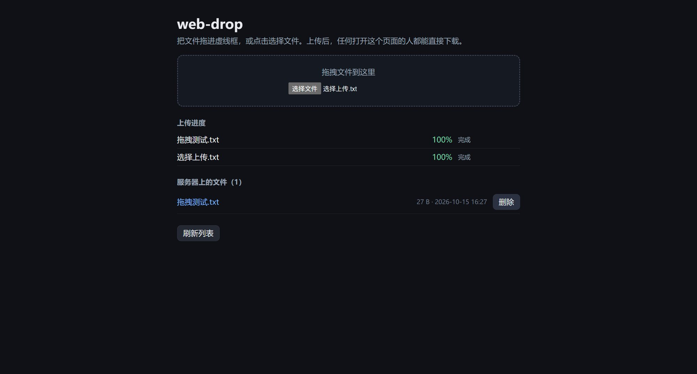

# web-drop — 点对点文件互传

浏览器上传 / 下载 / 删除文件的单页小站。前端 Angular 2 风格 TypeScript（ts2dart → AngularDart →
dart2js），后端 Django，同源托管：没有 CORS，也没有额外的静态服务器。

## 跑起来

    pwsh scripts/build_frontend.ps1                           # 构建前端
    ../.pyvenv/Scripts/python.exe backend/manage.py migrate   # 初始化数据库
    双击 start-control.vbs → 菜单 1) 起后端 → http://127.0.0.1:8130/

前置：`../.pyvenv`（Django editable）、Node、Dart 3.6+。

## 控制台（scripts/Control.ps1）

除前端构建外的运维都在这里（双击 `start-control.vbs`，优先 PowerShell 7、缺失回退 5.1）：

    1) 后端·本机    2) 后端·局域网    3) Cloudflare 隧道    4) ngrok 隧道
    5) 编辑 .env     6) 状态 / 诊断     7) 构建前端           0) 退出

    pwsh scripts/Control.ps1 -Action backend|lan|cloudflare|ngrok   # 不开菜单
    pwsh scripts/Control.ps1 -Port 8131                             # 临时换端口

隧道子菜单：启停 / 重启 / 复制公网地址 / 自检 / 日志。按 0)、Ctrl+C、关窗都会回收本控制台起的进程
（别人先起的后端只复用、不动）。

## 配置（repo/.env）

    MAX_UPLOAD_FILE_SIZE_MB=1024   # 单文件上限 MB，超了 413
    UPLOAD_CHUNK_SIZE_MB=8         # 分片大小 MB，别超 100
    WEBDROP_ALLOW_ANY_HOST=0       # 1 = 允许任意 Host（局域网用）
    WEBDROP_PORT=8130              # 端口
    NGROK_STATIC_DOMAIN=           # ngrok 固定域名，留空随机

在菜单 5) 里直接改；留空 = 回落默认值，改完重启后端。文件里只有可调参数，没有密钥。

## 访问方式

- **局域网**（手机同 Wi-Fi，最快）：菜单 2)，打印 `http://<本机 IP>:<端口>/`；首次可能要放行防火墙；
  校园 / 酒店 Wi-Fi 常做客户端隔离，那就改用隧道。
- **Cloudflare Quick Tunnel**：菜单 3)，拿到随机 `https://xxxx.trycloudflare.com`；新建的域名可能几分钟内
  解析不出来，手机打不开就等一会或换公共 DNS。
- **ngrok**：菜单 4)，免费号可用 `NGROK_STATIC_DOMAIN` 固定域名；HTML 请求会先弹一次确认页，同一时间
  只能跑一个端点。

**没有鉴权**：拿到链接的人都能上传 / 下载 / 删除，只适合临时交换，用完按 0) 停掉。

## 大文件（自动分片）

> 8 MiB 的文件自动分片：`POST /api/uploads/` 声明 → `PUT /api/uploads/<id>/<n>/` 每片 8 MiB、3 路并发 →
`POST /api/uploads/<id>/complete/` 合并。Cloudflare 单请求体上限 100 MB，超了会在上传将结束时被边缘拦成
413；分片落 `media/tmp/`，超 24 小时未完成的下次 init 时清扫。

## 其它

- 接口实现 `backend/files/views.py`；转译管线（手写 Dart 优先、`package:angular2` shim）`frontend/pipeline.js`
- 测试：`../.pyvenv/Scripts/python.exe backend/manage.py test files`
